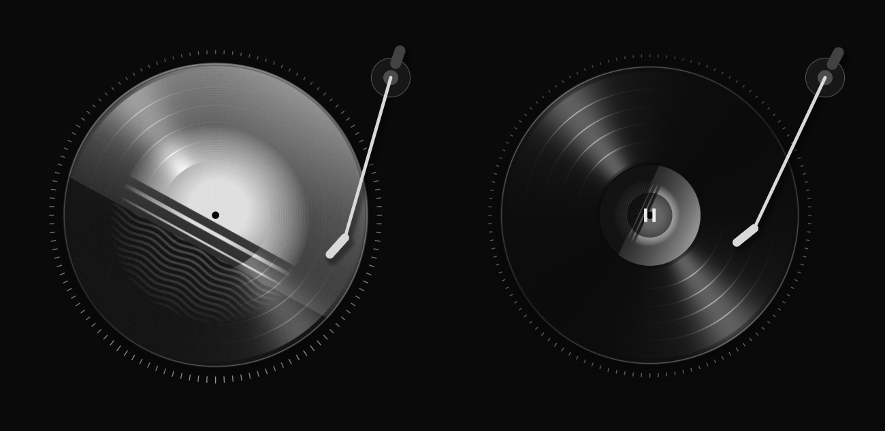

# Vinyl

A minimal Spotify visualizer for Linux: the current track's cover, in black and
white, on a slowly spinning record that floats over your desktop.



- **The cover becomes the record**: a picture disc, or black vinyl with the
  cover as its label. Black and white by default, or any two-color duotone.
- **It breathes with the beat**: the record swells a little on the hits you
  hear on top of the mix (drums, piano and guitar attacks, vocals), not on the
  bass line underneath. While someone sings, it swells with their voice (picked
  out from the centre of the stereo mix) and beats push it further on top. For songs carried by a melody
  that glides from note to note (a legato synth line), switch that song to
  pulse on every note. It stays perfectly round.
- **A tonearm** rests on the record while music plays and moves inward as the
  track goes. It lifts when you pause.
- **A faint ring of ticks** around the rim follows the spectrum.
- **It's an overlay, not a window**: no title bar, nothing in your taskbar,
  and clicks pass through everywhere except the record.
- **It can open and close with Spotify** on its own.

It needs no Spotify account setup or API keys. It reads the track and cover
from the Spotify desktop app over MPRIS. It listens only to Spotify's own audio
stream, so notifications and other apps don't move it.

## Requirements

- Linux with the **Spotify desktop app**
- **PipeWire** (with pipewire-pulse) or **PulseAudio**
- **Python 3.9+**, **GTK 3** with PyGObject, and **playerctl**
- For the overlay: a Wayland compositor with layer-shell support, such as
  **Hyprland, Sway, KDE Plasma, niri, river or Wayfire**, plus
  **gtk-layer-shell**. Elsewhere (GNOME, X11) Vinyl runs as a small borderless
  window instead.

You don't need to work these out yourself. `./install.sh` checks everything
and prints the exact command for anything missing. For reference:

| Distro | Packages |
| --- | --- |
| Arch, Manjaro, EndeavourOS, CachyOS | `sudo pacman -S --needed python-gobject python-cairo gtk3 gtk-layer-shell playerctl libpulse` |
| Debian, Ubuntu, Mint, Pop!_OS | `sudo apt install python3-venv python3-gi python3-gi-cairo python3-cairo gir1.2-gtk-3.0 gir1.2-gtklayershell-0.1 playerctl gir1.2-playerctl-2.0 pulseaudio-utils` |
| Fedora | `sudo dnf install python3-gobject python3-cairo gtk3 gtk-layer-shell playerctl pulseaudio-utils` |

`libpulse` and `pulseaudio-utils` only provide the `parec` and `pactl` command
line tools. They work alongside PipeWire and don't replace it.

## Install

```sh
git clone https://github.com/IcedLimes/vinyl-visualizer.git
cd vinyl-visualizer
./install.sh
```

The installer sets up a Python environment inside the folder, adds the
`vinyl-visualizer` command to `~/.local/bin` and puts **Vinyl** in your app
menu. Nothing is installed system-wide. Keep the folder where it is; if you
move it, run `./install.sh` again.

To update: `git pull && ./install.sh`.

## Use

Start Spotify, then run `vinyl-visualizer` or open **Vinyl** from your app
menu. Running it again hides it, and again shows it, which works well on a
keyboard shortcut.

| On the record | Does |
| --- | --- |
| Click the middle | Play / pause |
| Drag | Move it (it remembers where) |
| Scroll | Resize |
| Right-click | Play controls, what this song pulses on, quick toggles, Settings…, Hide, Quit |

Vinyl never takes keyboard input, so your keys always go to the window
you're using.

## Open and close with Spotify

`vinyl-visualizer --with-spotify` waits quietly in the background. It opens
Vinyl when Spotify starts and closes it when Spotify quits. To have it start
with your session:

| Desktop | Setup |
| --- | --- |
| KDE Plasma, GNOME, Xfce, Cinnamon (anything with XDG autostart) | `./install.sh --autostart` |
| Hyprland (`hyprland.conf`) | `exec-once = vinyl-visualizer --with-spotify` |
| Hyprland (Lua config) | `hl.exec_cmd("vinyl-visualizer --with-spotify")` inside your `hl.on("hyprland.start", ...)` block |
| Sway (`~/.config/sway/config`) | `exec vinyl-visualizer --with-spotify` |
| niri (`config.kdl`) | `spawn-at-startup "vinyl-visualizer" "--with-spotify"` |
| river (`init`) | `riverctl spawn "vinyl-visualizer --with-spotify"` |

It takes effect at your next login. To start it now, run the same command
once. If you quit Vinyl from its menu, it stays closed until Spotify next
starts.

## Settings

Right-click the record and choose **Settings…**, or run
`vinyl-visualizer --settings`. Changes apply straight away and are saved to
`~/.config/vinyl-visualizer/settings.json`.

| Setting | Default | |
| --- | --- | --- |
| Size | 380 px | Record diameter. You can also scroll on the record. |
| Spin speed | 8 rpm | Real records turn at 33⅓ or 45. |
| Spectrum ring | 40% | 0 turns it off. |
| Beat pulse | 50% | How much the record swells on the beat. 0 turns it off. |
| Pulse follows | Hits | What songs pulse on unless you've chosen otherwise for that song (right-click → *This song pulses on…*): **hits** (drums, chords, accents) or **every note** of the lead line. Per-song choices are remembered. |
| Vocals first | On | While someone is singing, the record swells with their voice and stays up through held notes, and beats still push it further on top. It finds the voice in the centre of the stereo mix, so it works best on songs with a centred lead vocal, and stays off for mono recordings. |
| Sync offset | 0 ms | Fine-tunes when the ring and pulse land relative to what you hear. Vinyl already waits out your output's latency (Bluetooth headphones delay the sound by 100–300 ms); positive values show them later, negative earlier. |
| Record | Picture disc | Or black vinyl with the cover as its label. |
| Track info | Always | Title and artist under the record: always, on hover or off. |
| Sits | Above windows | Or on the desktop, under your windows. |
| Tonearm | On | |
| Hide while Spotify is closed | On | Fades out, and lets clicks through, while Spotify isn't running. |
| Colors | Mono | The record is a duotone from **Shadows** to **Highlights** (black to white by default). **Accent** colors the ring, tonearm and text. Presets: Mono, Sepia, Slate, Crimson. |

Most settings also work from the command line. If Vinyl is already running,
they're sent to it:

```sh
vinyl-visualizer --size 500 --rpm 33.3 --pulse 0.8
vinyl-visualizer --style label --colors Sepia
vinyl-visualizer --layer bottom    # on the desktop, under windows
vinyl-visualizer --reset           # default settings and position
vinyl-visualizer --quit
```

These two take effect when Vinyl starts:

- `--audio system` reacts to everything you hear, not only Spotify.
- `--player NAME` follows another MPRIS player instead of Spotify. Run
  `playerctl -l` to see their names.

Run `vinyl-visualizer --help` for the full list.

## Troubleshooting

- **The ring and beat pulse don't move.** Vinyl needs `parec` and `pactl`
  (see Requirements). If Spotify's stream isn't found, it listens to your
  default output instead.
- **It opens as a normal window instead of an overlay.** Your desktop doesn't
  support layer-shell (GNOME, for example), or gtk-layer-shell isn't installed.
- **No cover or track info.** Vinyl follows the Spotify desktop app, not the
  web player. Check that `playerctl -l` lists `spotify`.
- **Clicking the record flashes your minimized windows (Hyprland).** If you
  minimize windows to a special workspace, Hyprland hands focus back to the
  last window you used when you click an overlay, even a minimized one, and
  that shows the whole workspace for a moment. A window rule that gives
  windows on that workspace `no_focus` stops it; in a Lua config:
  `hl.window_rule({ match = { workspace = "special:minimized" }, no_focus = true })`.
- **Anything else.** Run `vinyl-visualizer` from a terminal; any errors are
  printed there.

## Uninstall

```sh
./install.sh --uninstall
```

This removes the command, the menu entry, the autostart entry and the Python
environment. Your settings stay in `~/.config/vinyl-visualizer`; delete that
folder to forget them. If you added a line to your compositor's config,
remove that too.

## How it's built

| File | |
| --- | --- |
| `vinyl.py` | The overlay: GTK 3 layer-shell window, mouse and keyboard, menu, animation |
| `disc.frag`, `disc.py` | The record, ring and tonearm, drawn by one OpenGL shader (moderngl) |
| `spotify.py` | Track, position and cover from MPRIS (libplayerctl); covers turned black and white |
| `audio.py` | Spotify's audio stream through `parec`, analysed every 10.7 ms into spectrum levels and the beat pulse; reads the output latency from PipeWire |
| `follow.py` | The `--with-spotify` watcher: waits on D-Bus for Spotify to appear or quit |
| `settings.py`, `prefs.py` | Saved settings, color presets and the settings window |
| `hypr.py` | Hyprland IPC, for precise dragging |
